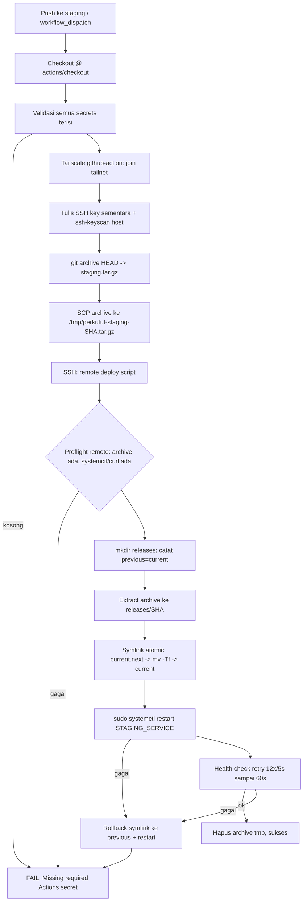

# Deploy Pipeline — Perkutut Cup (Staging)

Dokumen ini menjelaskan **mekanisme deploy lengkap** ke server staging agar agent/operator paham alur, prasyarat, cara operasi, dan batasannya. Fokus: server staging `100.120.68.54` (Tailscale, host `miwasan`) dan repo `kaylaradf/perkututcup`.

> **Keamanan:** jangan pernah menulis/commit nilai secret (`.env`, `TS_AUTHKEY`, SSH private key, DB URL, HMAC key). Dokumen ini hanya menyebut *nama* secret/variabel.

---

## 1. Ringkasan

Ada **dua jalur deploy**:

| Jalur | Pemicu | Kapan dipakai | Status prasyarat saat dokumen ini ditulis |
|---|---|---|---|
| **A. GitHub Actions (CI/CD)** | push ke branch `staging` atau `workflow_dispatch` | Jalur target/otomatis | Workflow ada: [`.github/workflows/staging-deploy.yml`](../.github/workflows/staging-deploy.yml). **Belum bisa jalan** sampai GitHub Environment `staging` punya semua secrets dan server punya `systemd` service persisten. |
| **B. Manual SCP/SSH (langsung)** | operator/agent menjalankan perintah | Fallback saat CI belum siap, atau hotfix terkontrol | **Pernah dipakai**; staging saat ini berjalan sebagai proses `uvicorn` `nohup` (bukan `systemd` service). |

Keduanya harus menjaga: `.env` server **tidak ditimpa/dibaca nilainya**, `.venv` server dipakai ulang (kecuali sengaja rebuild deps), dan proses lama dihentikan dengan cara yang bisa dipulihkan.

---

## 2. Komponen

| Komponen | Detail |
|---|---|
| Repo | `https://github.com/kaylaradf/perkututcup`, branch utama `main`, branch deploy CI: `staging` |
| Server staging | `root@100.120.68.54` (Tailscale), direktori app: `/home/agentuser/perkututcup` |
| Runtime app | FastAPI/uvicorn: `backend.app:app`, bind `0.0.0.0:8000` |
| Virtualenv | `/home/agentuser/perkututcup/.venv/bin/uvicorn` (Python 3.12 di server) |
| Konfigurasi rahasia | `/home/agentuser/perkututcup/.env` (milik server; **jangan salin ke GitHub**). Key yang diketahui dibutuhkan: `PERKUTUT_ALTCHA_HMAC_KEY`, `PERKUTUT_DATABASE_URL`. |
| Health check | `GET /health` → `200 {"status":"ok"}` (endpoint di `backend/app.py`) |
| Database | PostgreSQL, koneksi via `PERKUTUT_DATABASE_URL`. Migrasi skema dijalankan saat app startup (idempoten/backward-compatible harus dijaga). |

**Kondisi runtime aktual yang teramati (bisa berubah):**
- Proses aktif: `uvicorn backend.app:app --host 0.0.0.0 --port 8000` dijalankan sebagai `agentuser`, cwd `/home/agentuser/perkututcup`, diluncurkan via `nohup` (log sementara: `/tmp/perkutut-uvicorn.log`).
- **Tidak ada** `systemd` unit `perkututcup` (`systemctl is-enabled perkututcup` → not-found). Artinya restart setelah reboot **tidak otomatis** dan jalur CI yang memakai `systemctl restart <service>` **belum bisa** sampai unit dipasang.
- Belum ada layout release `releases/` + `current` symlink (yang diasumsikan workflow CI).

---

## 3. Jalur A — GitHub Actions (target)

Sumber: [`.github/workflows/staging-deploy.yml`](../.github/workflows/staging-deploy.yml), [`docs/STAGING-DEPLOY.md`](STAGING-DEPLOY.md).

### 3.1 Trigger & guard

```yaml
on:
  workflow_dispatch:
  push:
    branches: [staging]
concurrency:
  group: staging-deploy
  cancel-in-progress: false   # deploy tidak dibatalkan di tengah jalan
```

- Hanya branch `staging` yang auto-deploy. Perubahan di `main` **tidak** auto-deploy kecuali di-merge/di-push ke `staging` atau dijalankan manual dengan ref yang tepat.
- Environment: `staging` (tempat secrets disimpan).

### 3.2 Secrets yang wajib (GitHub Environment `staging`)

| Secret | Isi | Catatan |
|---|---|---|
| `TS_AUTHKEY` | Tailscale auth key untuk runner join tailnet | Perlu ACL/tag `tag:ci` sesuai tailnet policy. |
| `STAGING_SSH_PRIVATE_KEY` | Private key SSH untuk deploy | Public key dipasang di akun deploy server. |
| `STAGING_HOST` | Host/IP staging yang bisa dijangkau setelah Tailscale connect | `100.120.68.54` (Tailscale). |
| `STAGING_USER` | Akun SSH deploy | Harus bisa tulis `STAGING_DEPLOY_DIR` dan `sudo systemctl restart <service>` (terbatas ke service itu). |
| `STAGING_DEPLOY_DIR` | Direktori deploy absolut | Akan berisi `releases/` dan symlink `current`. |
| `STAGING_SERVICE` | Nama unit `systemd` | Unit harus menjalankan app dari `<STAGING_DEPLOY_DIR>/current` dan memuat env dari konfigurasi server (bukan dari workflow). |
| `STAGING_HEALTH_URL` | URL health check dari sisi host remote | Umum: `http://127.0.0.1:8000/health`. |

Workflow **gagal cepat** di step `Validate staging configuration` jika ada secret kosong. Tidak ada perubahan direktori deploy remote sebelum SSH valid dan perintah remote terverifikasi.

### 3.3 Alur CI (step demi step)



### 3.4 Detail remote deploy script (yang dijalankan via SSH)

Variabel: `deploy_dir`, `service`, `health_url`, `revision` (=`GITHUB_SHA`).

1. **Preflight (sebelum mutasi bermakna):** pastikan archive ada, `service`/`health_url` tidak kosong, `systemctl` dan `curl` tersedia.
2. `mkdir -p $deploy_dir/releases`.
3. Simpan `previous = readlink -f $deploy_dir/current` bila `current` symlink ada.
4. `mkdir $release=$releases/$revision` lalu extract archive ke sana.
5. **Atomic switch:**
   ```bash
   ln -sfn "$release" "$deploy_dir/current.next"
   mv -Tf "$deploy_dir/current.next" "$current"
   ```
6. Restart: `sudo systemctl restart $service`. Jika gagal → rollback.
7. **Health check:** `curl --fail -sS --max-time 5 $health_url` diulang 12 kali, jeda 5 detik (total ~60 detik). Jika gagal → rollback.
8. **Rollback (fungsi):** jika `previous` ada, kembalikan symlink `current` ke `previous` lalu restart service (`|| true`). Deploy pertama tanpa `previous`: tidak ada target rollback; kegagalan health check = butuh intervensi operator.
9. Bersihkan `/tmp/perkutut-staging-$revision.tar.gz`.

### 3.5 Apa yang *tidak* dilakukan workflow

- Tidak membaca/mentransfer/mencetak `.env` atau secret server.
- Tidak menginstall dependency Python dan tidak build container/image. Asumsi: runtime/deps sudah ada di server atau disediakan service.
- Tidak menjalankan migrasi DB eksplisit; migrasi berjalan saat app startup — **migrasi harus backward-compatible** dengan rilis sebelumnya karena rollback kode tidak membalik migrasi DB.

---

## 4. Jalur B — Manual SCP/SSH (fallback)

Gunakan saat CI belum siap atau saat perubahan perlu didorong terkontrol langsung ke staging. **Selalu** buat backup dan **jangan** sentuh `.env`.

### 4.1 Prasyarat

- Akses SSH: `ssh root@100.120.68.54` (atau akun yang sesuai) via Tailscale.
- Tahu proses app yang berjalan (cek `ps aux | grep '[u]vicorn backend.app:app'`).
- Punya cara restart yang setara dengan cara app dijalankan (saat ini: `nohup` sebagai `agentuser` dengan env dari `.env`).

### 4.2 Prosedur aman (ringkas)

```bash
# 1) Verifikasi target dan proses
ssh root@100.120.68.54 "hostname; ps aux | grep '[u]vicorn backend.app:app'; curl -sS -o /dev/null -w '%{http_code}\n' http://127.0.0.1:8000/health"

# 2) Backup (di server)
ssh root@100.120.68.54 "tar czf /tmp/perkututcup-backup-$(date +%Y%m%d-%H%M%S).tar.gz -C /home/agentuser perkututcup"

# 3) Paketkan source lokal (TANPA .git, .env, .venv, __pycache__)
tar --exclude='./.git' --exclude='./.env' --exclude='./.env.*' --exclude='./.venv' --exclude='__pycache__' -czf /tmp/perkututcup-deploy.tar.gz -C <repo-root> .

# 4) Upload
scp /tmp/perkututcup-deploy.tar.gz root@100.120.68.54:/tmp/perkututcup-deploy.tar.gz

# 5) Extract (preserve .env/.venv), fix ownership
ssh root@100.120.68.54 "cd /home/agentuser/perkututcup && tar xzf /tmp/perkututcup-deploy.tar.gz --exclude='.env' --overwrite && chown -R agentuser:agentuser ."

# 6) Restart app (mode nohup saat ini; ganti ke systemctl bila service sudah ada)
ssh root@100.120.68.54 "pkill -f 'uvicorn backend.app:app' || true; sleep 2; cd /home/agentuser/perkututcup && sudo -u agentuser bash -c 'set -a; . ./.env; set +a; nohup /home/agentuser/perkututcup/.venv/bin/uvicorn backend.app:app --host 0.0.0.0 --port 8000 > /tmp/perkutut-uvicorn.log 2>&1 &'; sleep 3; curl -sS -o /dev/null -w '%{http_code}\n' http://127.0.0.1:8000/health"
```

**Rollback manual:** extract dari `/tmp/perkututcup-backup-*.tar.gz` ke `/home/agentuser/perkututcup` (hati-hati: backup mungkin berisi `.env` lama milik server — perlakukan sebagai data sensitif, jangan sebarkan), lalu restart.

### 4.3 Batasan jalur manual

- Tidak atomic seperti symlink `current` (file ditimpa in-place). Window singkat saat extract+restart.
- Bergantung pada struktur runtime saat ini (`nohup`). Jika berpindah ke `systemd`, ganti langkah restart.
- Tidak otomatis pada push Git; repo Git di server mungkin tidak sinkron dengan working copy yang di-serve.

---

## 5. `systemd` service (dibutuhkan agar Jalur A penuh)

Workflow CI memanggil `sudo systemctl restart $service`. Service harus:
- menjalankan app dari `<STAGING_DEPLOY_DIR>/current` (agar symlink switch efektif),
- memuat environment dari file konfigurasi server yang terlindungi (mis. `EnvironmentFile=` menunjuk file di server; file itu **bukan** bagian artifact deploy),
- berjalan sebagai user non-root yang sesuai (atau sesuai kebijakan server),
- punya `Restart=` yang wajar.

Contoh *template* (sesuaikan path/user/env file; **review sebelum dipasang**):

```ini
[Unit]
Description=Perkutut Cup Staging
After=network.target

[Service]
Type=simple
User=agentuser
WorkingDirectory=/home/agentuser/staging/current
EnvironmentFile=/home/agentuser/perkututcup/.env
ExecStart=/home/agentuser/perkututcup/.venv/bin/uvicorn backend.app:app --host 0.0.0.0 --port 8000
Restart=on-failure
RestartSec=5

[Install]
WantedBy=multi-user.target
```

> Catatan: template di atas mengasumsikan `STAGING_DEPLOY_DIR=/home/agentuser/staging` dengan layout `current/releases` dan `venv/env` dikelola eksplisit. Layout aktual server saat ini berbeda (`/home/agentuser/perkututcup` flat, nohup). **Jangan** memasang/mengganti service tanpa rencana migrasi layout + rollback.

Akun deploy CI perlu sudoers terbatas, mis. hanya: `systemctl restart perkututcup-staging` (bukan sudo penuh).

---

## 6. Checklist operasi

**Sebelum deploy:**
- [ ] Perubahan sudah diuji/di-review seperlunya; `GET /health` ada bila workflow mengandalkannya.
- [ ] Migrasi DB (jika ada) backward-compatible dengan rilis sebelumnya.
- [ ] Tidak ada secret masuk commit/tarball (`.env`, key).

**Deploy CI:**
- [ ] Secrets environment `staging` lengkap.
- [ ] Server: `systemd` service + sudo terbatas + `bash/tar/curl/systemctl` + deps Python/venv siap.
- [ ] Push ke `staging` / jalankan workflow; pantau job dan health check.

**Deploy manual:**
- [ ] Backup dibuat.
- [ ] Proses target teridentifikasi (hanya `uvicorn backend.app:app` Perkutut).
- [ ] `.env` dan `.venv` tidak ditimpa.
- [ ] Health check `HTTP 200` di `127.0.0.1:8000` dan/atau `http://100.120.68.54:8000/health` setelah restart.

**Sesudah deploy:**
- [ ] Verifikasi endpoint utama (`/`, `/health`, alur login/register bila relevan).
- [ ] Catat commit/revision yang aktif.

---

## 7. Troubleshooting cepat

| Gejala | Cek | Arah perbaikan |
|---|---|---|
| Workflow gagal di “Validate staging configuration” | Log GitHub Actions | Tambah/lengkapi secrets di Environment `staging`. |
| Tailscale connect gagal | `TS_AUTHKEY`, ACL/tag `tag:ci` | Perbaiki key/policy tailnet. |
| `systemctl` gagal / unit not found | `systemctl status/cat <service>` di server | Pasang unit, perbaiki sudoers, pastikan `STAGING_SERVICE` benar. |
| Health check gagal setelah restart | `curl http://127.0.0.1:8000/health`, `/tmp/perkutut-uvicorn.log` atau journal service, env keys ada | App crash/env hilang/deps; rollback ke rilis sebelumnya. |
| `/health` 404 di proses lama | Proses masih menjalankan kode lama | Pastikan restart memuat kode baru; verifikasi `grep def health backend/app.py` di path yang dijalankan. |
| DB/migrasi error saat startup | Log app + skema DB | Migration harus idempoten/backward-compatible; perbaiki migrasi lalu redeploy; rollback kode tidak membalik DB. |
| App mati setelah reboot (mode nohup) | `ps`, `systemctl is-enabled` | Pasang `systemd` service persisten. |

---

## 8. Gap saat ini (agar agent tidak salah asumsi)

1. **CI belum end-to-end:** secrets GitHub belum dikonfigurasi; server belum punya `systemd` unit + layout `releases/current` yang cocok. Workflow = *siap di repo*, bukan *aktif di produksi/staging*.
2. **Runtime manual:** staging berjalan via `nohup` sebagai `agentuser`; restart manual diperlukan jika proses mati/reboot.
3. **Repo server vs kode jalan:** deploy manual menimpa file; git working copy di server bisa tidak sinkron dan punya isu ownership bila dioperasikan sebagai root.
4. **Branch model:** CI memicu pada `staging`; tim saat ini sering push ke `main`. Pilih konvensi (deploy dari `main`, atau merge `main`→`staging`).

---

## 9. Referensi file

- [`.github/workflows/staging-deploy.yml`](../.github/workflows/staging-deploy.yml) — definisi CI/CD staging.
- [`docs/STAGING-DEPLOY.md`](STAGING-DEPLOY.md) — ringkas konfigurasi secrets dan perilaku workflow.
- [`backend/app.py`](../backend/app.py) — app FastAPI, termasuk `GET /health`.
- [`backend/migrations/0001_initial_schema.sql`](../backend/migrations/0001_initial_schema.sql) — migrasi awal (startup/idempoten).
- [`docs/UPDATES.md`](UPDATES.md) — changelog (v2.4 mencatat `/health` dan workflow staging).